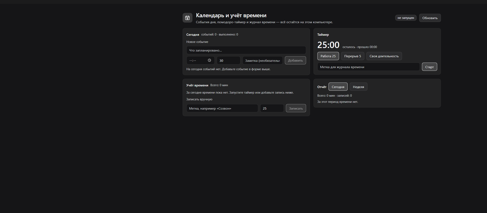

# dsh-calendar

Календарь и учёт времени в левой панели DSH: события дня, помодоро-таймер, журнал
времени и отчёты за сегодня и неделю — без внешних сервисов и без интернета.



## Что это и зачем

DSH (DeepSeek Harness) — приложение, в котором вы общаетесь с ассистентом и
работаете с файлами. Этот плагин добавляет к нему личный календарь и учёт времени:
что запланировано на день, сколько вы работали и на что ушло время.

Основные слова, которые встретятся дальше:

| Термин | Что это простыми словами |
|---|---|
| Событие | запись в календаре: название, дата, время, длительность, заметка |
| Помодоро | работа отрезками: 25 минут работы, 5 минут перерыва |
| Таймер | счётчик отрезка; работает на сервере DSH, а не в открытой вкладке |
| Журнал времени | список учтённых отрезков с метками и суммами |
| Метка | подпись отрезка: «Работа», «Созвон», «Код» — по ней строится отчёт |
| Отчёт | сумма времени за сегодня или за текущую неделю и разбивка по меткам |

Всё хранится только на этом компьютере в файле `~/.dsh/dsh-calendar/data.json`.
Плагин ничего не отправляет в сеть, не требует токенов и не синхронизируется
между устройствами: это осознанное ограничение первой версии.

Ассистент тоже умеет работать с календарём: у него есть инструменты
`calendar_today`, `calendar_add`, `calendar_list`, `timer_start`,
`timer_status`, `timer_stop` и `time_report`. Поэтому календарь можно вести
словами: «что у меня сегодня», «запусти таймер на 25 минут», «сколько я работал
за неделю».

## Как открыть

1. Левая панель DSH: значок календаря с часами, подпись «Календарь». Он стоит рядом
   с «Расходами», «Синхронизацией» и «Плагинами».
2. Нажмите на значок — календарь откроется в основной области, как обычная
   страница: заголовок «Календарь и учёт времени» и четыре блока.
3. Если значка нет — откройте «Плагины» → «Календарь и учёт времени»: на странице
   плагина есть краткая справка и кнопка «Открыть календарь». Сама страница
   плагина больше не дублирует календарь.
4. Пока идёт таймер, в правом нижнем углу виден плавающий чип с остатком `24:59`:
   он остаётся на месте, даже когда открыта другая страница. Клик по чипу
   открывает календарь.

Четыре блока страницы:

- «Сегодня» — список событий дня и быстрый ввод;
- «Таймер» — большой счётчик и кнопки «Старт» / «Пауза» / «Стоп»;
- «Учёт времени» — записи за сегодня, их сумма и ручное добавление;
- «Отчёт» — переключатель «Сегодня» / «Неделя» и разбивка по меткам.

На широком экране блоки стоят двумя колонками, на узком — в одну.

## Как пользоваться пошагово

**Добавить событие.**

1. В блоке «Сегодня» заполните поле «Что запланировано…».
2. Укажите время (по умолчанию — текущее) и длительность в минутах (по умолчанию
   30). Заметка необязательна.
3. Нажмите «Добавить».
4. Ожидаемый результат: строка вида `14:00–14:45 ○ Созвон — важно` появилась в
   списке, счётчик событий увеличился. Событие сохранилось в `data.json`, его
   видит и ассистент.

**Отметить событие и удалить.**

1. Нажмите кружок слева от события — `○` станет `✓`, название зачёркнуто. Ещё
   одно нажатие снимает отметку.
2. Кнопка «Удалить» спрашивает «Удалить это событие?»; «Да, удалить» убирает
   запись насовсем, «Нет» отменяет.

**Запустить таймер.**

1. В блоке «Таймер» выберите режим: «Работа 25», «Перерыв 5» или «Своя
   длительность» (тогда введите число минут).
2. При желании впишите метку — она попадёт в журнал времени и в отчёт.
3. Нажмите «Старт». Ожидаемый результат: большой счётчик пошёл вниз, статус
   «идёт», кнопка «Старт» стала «Пауза».
4. «Пауза» останавливает счётчик, «Продолжить» запускает его с того же места,
   «Стоп» завершает отрезок и записывает рабочее время в журнал.
5. Когда время вышло, страница показывает «время вышло», играет короткий звук, а
   в журнал ничего не пишется до нажатия «Стоп» — так вы сами решаете, записывать
   ли отрезок.
6. Пока таймер идёт, в правом нижнем углу висит чип с остатком (`● 24:59 Код`).
   Он виден и на других страницах DSH; клик открывает календарь.

Таймер работает на сервере DSH: можно свернуть вкладку, перезапустить DSH —
отрезок продолжается. Если DSH был закрыт дольше, чем длился таймер, после
запуска плагин покажет «время вышло» и предложит нажать «Стоп»: в журнал попадут
запланированные минуты, а не всё время простоя компьютера.

**Записать время вручную.**

1. В блоке «Учёт времени» впишите метку, например «Созвон», и число минут.
2. Нажмите «Записать». Ожидаемый результат: строка в журнале с временем начала и
   конца, сумма за сегодня пересчитана.

**Посмотреть отчёт.**

1. В блоке «Отчёт» нажмите «Сегодня» или «Неделя». Неделя начинается с
   понедельника.
2. Ожидаемый результат: сумма времени, число записей и полоски по меткам с долей
   в процентах. Переключение не теряет данные: отчёт всегда строится по журналу.

## Примеры

**Фразы ассистенту.**

> Что у меня сегодня?

`calendar_today` вернёт события дня, статус таймера и учтённое время.

> Добавь событие «Созвон» на 14:00 на 45 минут, заметка «важно».

`calendar_add({ "title": "Созвон", "time": "14:00", "durationMin": 45, "note": "важно" })`.

> Запусти таймер на 25 минут с меткой «Код».

`timer_start({ "label": "Код", "durationMin": 25 })`.

> Сколько я работал за неделю?

`time_report({ "range": "week" })`.

> Останови таймер.

`timer_stop` запишет отрезок в журнал и очистит таймер.

**Что происходит с датами.** Всё в локальной зоне компьютера: «сегодня» — это
ваш сегодняшний день, «неделя» — с понедельника по воскресенье. Внутри файла
время хранится в UTC, чтобы файл не зависел от часового пояса.

**Маршруты** (для разработки; все `POST`, ответ JSON):

| Маршрут | Тело | Назначение |
|---|---|---|
| `/api/dsh-calendar/state` | `{}` | события дня, таймер, журнал за день, отчёты today/week |
| `/api/dsh-calendar/event/add` | `title`, `date?`, `start?`, `durationMin?`, `note?` | добавить событие |
| `/api/dsh-calendar/event/toggle` | `id` | переключить «выполнено» |
| `/api/dsh-calendar/event/remove` | `id` | удалить событие |
| `/api/dsh-calendar/timer` | `action`: `start` / `break` / `pause` / `resume` / `stop`, `label?`, `durationMin?`, `sessionId?` | управление таймером |
| `/api/dsh-calendar/log/add` | `label`, `durationMin`, `date?` | записать время вручную |
| `/api/dsh-calendar/report` | `range`: `today` / `week` | отчёт по журналу |

**Инструменты ассистента.**

| Инструмент | Параметры | Что делает |
|---|---|---|
| `calendar_today` | — | события сегодня, таймер, время за день |
| `calendar_add` | `title`, `date?`, `time?`, `durationMin?`, `note?` | добавить событие |
| `calendar_list` | `days?` (1–31, по умолчанию 7) | события с сегодня на N дней |
| `timer_start` | `label?`, `durationMin?` (1–720), `sessionId?` | запустить работу |
| `timer_status` | — | режим, метка, прошло, осталось |
| `timer_stop` | — | остановить и записать в журнал |
| `time_report` | `range`: `today` / `week` | отчёт по меткам |

## Что вы увидите

| Элемент | Как выглядит |
|---|---|
| Значок в левой панели | маленькая иконка календаря с часами, подпись «Календарь» |
| Заголовок страницы | «Календарь и учёт времени», подсказка и кнопка «Обновить» |
| Статус таймера | «не запущен», «идёт», «на паузе», «время вышло» рядом с заголовком |
| Строка события | `14:00–14:45 ○ Созвон — важно`, кружок `○`/`✓`, справа «Удалить» |
| Форма события | поля названия, времени, минут и заметки, кнопка «Добавить» |
| Счётчик таймера | крупные цифры `24:59`, рядом «осталось · прошло 00:01 · 25 мин» |
| Режимы | «Работа 25», «Перерыв 5», «Своя длительность» с полем минут |
| Кнопки таймера | «Старт» / «Пауза» / «Продолжить» и красная «Стоп» |
| Плавающий чип | `● 24:59 Код` в правом нижнем углу, пока таймер идёт |
| Окончание таймера | звук и строка «Таймер дошёл до конца — нажмите «Стоп»…» |
| Журнал | строки `09:00–09:25 Работа 25 мин таймер`, сумма «Всего: …» |
| Ручная запись | поля метки и минут, кнопка «Записать» |
| Отчёт | «Всего: 1 ч 10 мин · записей: 3» и полоски по меткам |

## Частые ошибки и что делать

| Симптом | Причина | Что делать |
|---|---|---|
| «Название события не может быть пустым.» | пустое поле | Впишите название |
| «Таймер уже идёт: сначала остановите его.» | попытка запустить второй таймер | Нажмите «Стоп» и запустите снова |
| «Таймер не запущен.» | «Стоп»/«Пауза» без старта | Нажмите «Старт» |
| «Время вышло» после запуска DSH | таймер закончился, пока DSH был закрыт | Нажмите «Стоп»: запишутся запланированные минуты |
| Отчёт пуст | в этом периоде нет записей | Запустите таймер или добавьте запись вручную |
| Время в отчёте не то | запись попала в другой день | Проверьте дату записи; границы дня — по локальной зоне |
| «Укажите длительность в минутах…» | ноль или пустое поле | Введите целое число минут больше нуля |
| Страница пишет «Не удалось загрузить…» | файл данных занят или повреждён | Нажмите «Повторить»; повреждённый файл читается как пустой |
| Нет значка в левой панели | плагин выключен или DSH не перезапущен | «Плагины», включите, перезапустите DSH |
| «Открыть календарь» не работает | хост без службы навигации | Нажмите значок календаря в левой панели вручную |
| Событие пропало | переполнен журнал событий | Хранятся последние 2000 событий; старые вытесняются |

## Ограничения и безопасность

- Данные только локальные: `~/.dsh/dsh-calendar/data.json`. Синхронизации между
  устройствами нет, в интернет плагин не ходит.
- Время хранится в UTC, показывается в локальной зоне. Перенос файла на машину с
  другим поясом не сдвигает моменты, но «сегодня» будет уже другим днём.
- Одновременно может идти только один таймер: работа или перерыв.
- События и журнал хранят до 2000 записей каждый; более старые вытесняются.
- Перерывы не попадают в журнал времени: учитывается только работа.
- Таймер, завершившийся без DSH, при остановке пишет запланированную
  длительность, а не всё время простоя.
- Удаление события не удаляет записи журнала, и наоборот.
- Нет напоминаний, повторяющихся событий и календарей на несколько человек —
  это вторая версия (0.2.0), первая с панелью в левой части экрана.
- Плавающий чип и кнопка «Открыть календарь» используют службу навигации
  `ctx.layout` из веб-клиента DSH 0.2.x; клиентская часть объявляет её в
  `inject`, поэтому на несовместимой версии DSH панель просто не появится.
- Файл не шифруется: его видит любой, у кого есть доступ к вашему профилю
  Windows. Секретов и токенов в нём нет.
- Запись атомарная: сначала временный файл, потом замена. Если антивирус или
  редактор держат файл, плагин повторяет попытку, а в крайнем случае пишет
  напрямую.

## Связанные плагины

- `dsh-notify` — уведомления DSH; таймер этого плагина звук даёт сам, а системные
  уведомления — отдельный плагин.
- `dsh-expenses` — учёт расходов: тот же подход «локальный файл + отчёты».
- `dsh-cards` — карточки в ответах ассистента.
- `dsh-review` — рабочее место после правок кода.
- `dsh-team` — панель командной работы нескольких ассистентов.

## Установка

Плагин лежит в `.publish/dsh-calendar` этого воркспейса и пока не опубликован на
GitHub. Подключить его к профилю можно локальной ссылкой, как это сделано для
других локальных плагинов:

```jsonc
// ~/.dsh/profiles/desktop/package.json
"dependencies": {
  "dsh-calendar": "link:E:/DeepSeek Harness/.publish/dsh-calendar"
},
"dsh": {
  "profile": {
    "bundles": [/* … */, "dsh-calendar"]
  }
}
```

Затем `pnpm install` в каталоге профиля и перезапуск DSH. После публикации
установка станет обычной: `dsh plugin --profile desktop add <пакет>`.

## Проверка

```powershell
cd "E:\DeepSeek Harness\.publish\dsh-calendar"
node --check index.js
node --check client.js
node --test test/*.test.mjs
```

Покрыто тестами: хранилище (миграция старого файла, лимит 2000 записей,
атомарная запись), таймер (старт/пауза/стоп/перерыв, длительность, восстановление
после перезапуска), события (добавление, сортировка, отметка, удаление), отчёты
today/week (границы, разбивка по меткам), все POST-маршруты, все семь
инструментов, регистрация слотов `main` / `sidebar.panellist` / `shell.overlay` и
краткой секции плагина, рендер страницы и иконки на фейковом React, совпадение
словарей ru/en.
