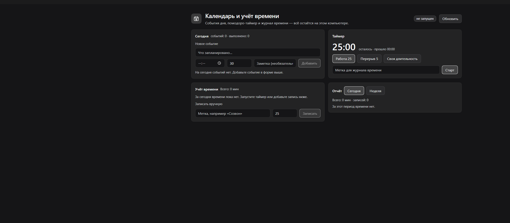

# dsh-calendar — подробное описание

Плагин «Календарь и учёт времени» для DeepSeek Harness (DSH) 0.2.x: события дня,
серверный помодоро-таймер, журнал учтённого времени и отчёты за сегодня и неделю.
Документ рассчитан на новичка: сначала «что и зачем», потом пошаговая работа,
потом устройство и ограничения.

## Как это выглядит



*Страница «Календарь и учёт времени» в левой панели: события, таймер, журнал и отчёт.*

## Что это и зачем

DSH — приложение, где вы общаетесь с ассистентом и работаете с проектами. Плагин
добавляет к нему личный календарь и учёт времени. Он не заменяет системный
календарь и не синхронизируется с Google/Outlook: это быстрый локальный журнал
дня, который видит и вы, и ассистент.

Три вещи, которые плагин делает:

1. **События дня.** Запись с названием, датой, временем, длительностью и заметкой.
   Событие можно отметить выполненным и удалить.
2. **Помодоро-таймер.** Отрезок работы 25 минут, перерыв 5 минут или своя
   длительность. Таймер считает сервер DSH, поэтому переживает закрытие вкладки и
   перезапуск приложения.
3. **Учёт времени и отчёты.** Каждый завершённый рабочий отрезок попадает в
   журнал с меткой. Отчёт за сегодня или за текущую неделю показывает сумму и
   разбивку по меткам.

Слова, которые встретятся дальше:

| Термин | Простыми словами |
|---|---|
| Событие | запись календаря: «Созвон, 14:00, 45 минут» |
| Таймер | счётчик отрезка; хранит только время старта, остальное вычисляется |
| Перерыв | отрезок отдыха; в журнал времени не пишется |
| Журнал | список учтённых отрезков с датой, меткой и длительностью |
| Метка | подпись отрезка: «Работа», «Код», «Созвон» |
| Отчёт | сумма времени за период и доли меток в процентах |
| data.json | единственный файл данных плагина в `~/.dsh/dsh-calendar` |

Ассистенту доступны семь инструментов: `calendar_today`, `calendar_add`,
`calendar_list`, `timer_start`, `timer_status`, `timer_stop`, `time_report`.
Инструменты и страница работают с одним и тем же состоянием: событие,
добавленное словами, сразу видно на странице, а таймер, запущенный кнопкой,
виден ассистенту.

## Как открыть

1. Левая панель DSH: значок календаря с часами, подпись «Календарь». Пункт стоит
   рядом с «Расходами», «Синхронизацией сессий» и «Плагинами».
2. Нажмите на значок: календарь откроется в основной области, как обычная
   страница. Слева заголовок «Календарь и учёт времени», справа статус таймера и
   кнопка «Обновить».
3. Если значка нет, откройте «Плагины» → «Календарь и учёт времени». На странице
   плагина теперь краткая справка и кнопка «Открыть календарь»: она вызывает
   `ctx.layout.selectPanel('calendar')`. Если хост не даёт службу навигации,
   кнопка честно скажет нажать значок в левой панели.
4. Пока идёт таймер, в правом нижнем углу виден плавающий чип с остатком
   (`● 24:59 Код`). Он регистрируется в `shell.overlay` и остаётся на экране на
   любой странице; клик открывает панель, если навигация доступна.

Если панель не появилась:

- проверьте, что плагин включён в «Плагинах» и DSH перезапущен после установки;
- откройте консоль браузера: ошибки `[dsh-calendar] панель в левой панели
  недоступна` или `[dsh-calendar] секция страницы недоступна` означают проблему
  регистрации слота (обычно несовпадение версии DSH);
- данные плагина не зависят от интерфейса: даже без панели работают инструменты
  ассистента.

## Как пользоваться пошагово

### Событие

**Добавить.**

1. Блок «Сегодня» → поле «Что запланировано…».
2. Поле времени (по умолчанию — текущее время с точностью до минуты) и поле
   минут (по умолчанию 30, допустимо от 5 до 1440).
3. Заметка — по желанию, до 500 символов.
4. «Добавить».

Ожидаемый результат: строка `14:00–14:45 ○ Созвон — важно` в списке; счётчик
«событий: 1 · выполнено: 0». Если название пустое — кнопка неактивна, а из
инструмента придёт ошибка «Название события не может быть пустым.».

**Отметить.**

Нажмите кружок слева: `○` → `✓`, название зачёркнуто, событие считается
выполненным. Повторное нажатие снимает отметку.

**Удалить.**

«Удалить» → вопрос «Удалить это событие?» → «Да, удалить» (или «Нет»). Удаление
необратимо; записи журнала времени оно не затрагивает.

**Куда попадает.** Сегодняшние события видны в блоке «Сегодня», будущие — через
`calendar_list` (по умолчанию 7 дней вперёд). Сортировка — по времени начала.

### Таймер

**Запустить.**

1. Выберите режим: «Работа 25», «Перерыв 5» или «Своя длительность» (поле минут
   от 1 до 720).
2. При желании впишите метку; без неё будет «Работа» или «Перерыв».
3. «Старт».

Ожидаемый результат: статус «идёт», большой счётчик уменьшается каждую секунду,
рядом «осталось · прошло 00:00 · 25 мин», а в правом нижнем углу появляется чип
`● 24:59 с меткой`. Чип виден на любой странице DSH, пока таймер не остановлен.

**Пауза и продолжение.**

- «Пауза» — время замирает, статус «на паузе».
- «Продолжить» — счётчик идёт дальше; пауза в длительность не засчитывается.
- «Стоп» — отрезок завершается: если это была работа, в журнал попадает
  прошедшее время (например, 7 минут), таймер становится «не запущен».

**Окончание.**

Когда время вышло, страница показывает «время вышло» и короткий звук, а также
строку «Таймер дошёл до конца — нажмите «Стоп»…». Чип в углу становится красным и
показывает `00:00`. Само по себе время в журнал не пишется: «Стоп» — ваше решение
записать отрезок.

**Перезапуск DSH.** Таймер продолжается: в файле хранится только время старта и
длительность, остальное вычисляется при каждом обращении. Если DSH был закрыт
дольше, чем длился таймер, после запуска появится «время вышло» и предложение
завершить. Тогда «Стоп» запишет **запланированные** минуты (25 из 25), а не всё
время простоя компьютера.

**Перерыв.** Перерыв не пишется в журнал: учитывается только работа. Сообщение
после остановки — «Перерыв завершён: в журнал времени перерывы не записываются.».

### Ручная запись времени

В блоке «Учёт времени»: метка (например, «Созвон») и минуты, затем «Записать».
Ожидаемый результат: строка `10:00–10:30 Созвон 30 мин вручную`, сумма «Всего: …»
пересчитана. Ручная запись нужна, когда работу не засекали таймером.

### Отчёт

Кнопки «Сегодня» / «Неделя» в блоке «Отчёт». Неделя — с понедельника 00:00 по
воскресенье 23:59 локального времени.

Ожидаемый результат:

- «Всего: 1 ч 10 мин · записей: 3»;
- полоски меток: «Работа: 1 ч (86%)», «Созвон: 10 мин (14%)»;
- если записей нет — «За этот период времени нет.».

Отчёт строится по моменту окончания записи: отрезок, начавшийся до полуночи,
считается в дне, когда он закончился.

## Что вы увидите

| Элемент | Как выглядит |
|---|---|
| Значок в левой панели | иконка календаря с часами и подпись «Календарь» |
| Заголовок страницы | «Календарь и учёт времени», подсказка, статус таймера, «Обновить» |
| Раскладка | две колонки блоков на широком экране, одна колонка на узком |
| Блок «Сегодня» | счётчик событий, форма добавления, список строк |
| Кружок события | `○` не выполнено, `✓` выполнено (строка зачёркнута) |
| Время события | `09:00–09:30`, длительность «30 мин» |
| «Удалить» | серая кнопка, затем подтверждение «Да, удалить» / «Нет» |
| Блок «Таймер» | крупный счётчик `24:59`, статус справа |
| Режимы | три кнопки, выбранная подсвечена |
| «Своя длительность» | поле минут рядом с кнопками |
| «Старт» | главная кнопка; во время работы — «Пауза»/«Продолжить» |
| «Стоп» | красная кнопка, видна только когда таймер не «idle» |
| Плавающий чип | `● 24:59 Код` в правом нижнем углу; красный при «время вышло» |
| Окончание | красная строка «время вышло» + звук |
| Блок «Учёт времени» | строки журнала, «Всего: …», форма ручной записи |
| Блок «Отчёт» | переключатель, сумма, полоски меток с процентами |
| Справка на странице плагина | абзац «календарь открывается в левой панели» и кнопка «Открыть календарь» |
| Ошибки запроса | красная строка под заголовком; кнопка «Повторить» при неудачной загрузке |

## Как это устроено

### Слои

- `index.js` — Host-часть: читает файл, регистрирует POST-маршруты
  (`ctx.connection.fetch.register`) и семь инструментов (`ctx.tools.register`).
  И то и другое живёт в `ctx.effect`, поэтому выгрузка или замена плагина снимает
  регистрации.
- `client.js` — браузерная часть: пункт в левой панели, страница в `main`,
  плавающий чип в `shell.overlay` и краткая справка в `plugins.detail.section`.
  Работает через `ctx.locale` (словари ru/en) и `ctx.slots`; внешних модулей,
  кроме React, не требует.
- `lib/` — чистые модули без побочных эффектов: `time.mjs` (локальные даты),
  `storage.mjs` (файл, миграция, CRUD), `timer.mjs` (математика таймера),
  `reports.mjs` (отчёты), `format.mjs` (тексты инструментов), `tools.mjs`
  (определения инструментов), `paths.mjs` (каталог данных).
- `test/` — тесты на `node --test`, без сети.

### Файл данных

`~/.dsh/dsh-calendar/data.json`, каталог можно переопределить переменной
`DSH_CALENDAR_DIR` (так делают тесты). Формат версии 1:

```json
{
  "version": 1,
  "events": [
    {
      "id": "ev-m1x2-abc",
      "title": "Созвон",
      "start": "2026-01-15T11:00:00.000Z",
      "end": "2026-01-15T11:45:00.000Z",
      "note": "важно",
      "done": false,
      "createdAt": "2026-01-15T08:00:00.000Z"
    }
  ],
  "timer": {
    "mode": "work",
    "startedAt": "2026-01-15T05:00:00.000Z",
    "label": "Код",
    "durationMin": 25,
    "pausedAt": "",
    "sessionId": ""
  },
  "log": [
    {
      "id": "log-m1x2-def",
      "label": "Работа",
      "startedAt": "2026-01-15T05:00:00.000Z",
      "endedAt": "2026-01-15T05:25:00.000Z",
      "durationSec": 1500,
      "source": "timer"
    }
  ]
}
```

- `mode` таймера: `idle` (нет отрезка), `work`, `break`; при `idle` остальные
  поля пустые.
- `pausedAt` — момент паузы; нужен, чтобы при продолжении сдвинуть `startedAt` и
  не засчитать паузу.
- `source` записи журнала: `timer` (остановленный таймер) или `manual` (ручная
  запись).
- Оба массива хранят до 2000 записей; старые вытесняются, а не копятся бесконечно.

**Миграция.** `normalizeState` принимает файл любой версии: понимает старые имена
`items`/`entries`, старые события с полями `date` + `time` вместо `start`, чинит
отсутствующие поля и отбрасывает битые записи. Разбитый JSON читается как пустое
состояние, поэтому страница не перестаёт открываться.

**Атомарность.** Запись идёт во временный файл `<data.json>.<pid>.<время>.<случ>.tmp`,
затем `rename` поверх настоящего. На Windows `rename` иногда блокируется
антивирусом или редактором (`EPERM`/`EBUSY`/`EACCES`) — плагин делает несколько
коротких повторов, затем пишет файл напрямую. Все записи в Host сериализованы
цепочкой промисов.

### Таймер: почему он переживает перезапуск

В файле нет ни интервалов, ни оставшихся секунд — только `startedAt` и
`durationMin`. При любом запросе состояние считается заново:

```
прошло   = now - startedAt            (или pausedAt - startedAt на паузе)
осталось = max(0, durationMin*60 - прошло)
истёк    = не на паузе и осталось = 0
```

Отсюда следствия:

- закрытая вкладка и перезапуск DSH ничего не теряют;
- пауза заменяет `startedAt` на «сейчас минус уже прошедшее время» при
  продолжении, поэтому пауза не входит в длительность;
- просроченный таймер не завершается сам: страница и `timer_status` показывают
  `expired`, а `timer_stop` пишет запланированную длительность и очищает таймер.

### Маршруты

Все маршруты — `POST` с JSON-телом, ответ JSON. Ошибка всегда `{ ok: false,
message }` с понятным русским текстом.

| Маршрут | Тело | Ответ |
|---|---|---|
| `/api/dsh-calendar/state` | `{}` | `{ ok, version, now, today, timer, logToday, recent, report, limits }` |
| `/api/dsh-calendar/event/add` | `title`, `date?`, `start?`, `durationMin?`, `note?` | `{ ok, event, message }` |
| `/api/dsh-calendar/event/toggle` | `id` | `{ ok, event, message }` |
| `/api/dsh-calendar/event/remove` | `id` | `{ ok, message }` |
| `/api/dsh-calendar/timer` | `action`: `start`/`break`/`pause`/`resume`/`stop`, `label?`, `durationMin?`, `sessionId?` | `{ ok, action, timer, message, log }` |
| `/api/dsh-calendar/log/add` | `label`, `durationMin`, `date?` | `{ ok, entry, message }` |
| `/api/dsh-calendar/report` | `range`: `today`/`week` | `{ ok, report }` |

`date` — `YYYY-MM-DD` в локальной зоне, `start` — либо `HH:MM`, либо полный ISO
момент. Без даты берётся сегодня, без времени — текущее время.

### Инструменты

| Инструмент | Параметры | Результат |
|---|---|---|
| `calendar_today` | — | события сегодня, строка таймера, время и метки за день |
| `calendar_add` | `title` (обязательно), `date?`, `time?`, `durationMin?`, `note?` | подтверждение с датой и временем |
| `calendar_list` | `days?` 1–31 | события с сегодня на N дней, сгруппированные по датам |
| `timer_start` | `label?`, `durationMin?` 1–720, `sessionId?` | подтверждение и остаток |
| `timer_status` | — | режим, метка, прошло, осталось, признак `expired` |
| `timer_stop` | — | результат остановки и запись в журнал |
| `time_report` | `range?`: `today`/`week` | сумма, число записей, разбивка по меткам |

Описания инструментов намеренно короткие (до 180 символов): это ограничение
провайдера модели, и его проверяет тест.

### Клиент

Плагин регистрирует четыре клиентских слота из `apply` (все — через
`ctx.slots.inject` + `ctx.slots.register`, поэтому выгрузка плагина снимает их):

| Слот | Регистрация | Что показывает |
|---|---|---|
| `main` | `{ name: 'main', key: 'calendar' }` | полная страница календаря в основной области |
| `sidebar.panellist` | `{ name: 'sidebar.panellist', id: 'calendar', order: 4, label: () => translate('panel'), locale: 'dshCalendar' }` | значок календаря с часами в левой панели |
| `shell.overlay` | `{ name: 'shell.overlay', id: 'calendar.timer', order: 44 }` | плавающий чип остатка таймера |
| `plugins.detail.section` | `{ name: 'plugins.detail.section', id: 'dsh-calendar-detail', order: 47, locale: 'dshCalendar' }` | краткая справка и кнопка «Открыть календарь» |

- Клиент объявляет `inject: ['slots', 'locale', 'layout']`: служба `layout`
  (`dsh-client-ui-layout`) даёт `ctx.layout.selectPanel('calendar')` для кнопки
  справки и клика по чипу, необязательные вызовы защищены проверкой.
- Идентификатор пункта в левой панели (`id`) совпадает с ключом страницы
  (`key`): по этому совпадению хост связывает значок и страницу, как у
  «Расходов» и «Плагинов».
- Кнопка «Открыть календарь» в справке вызывает `ctx.layout.selectPanel('calendar')`.
  Если службы нет, кнопка показывает подсказку «нажмите значок в левой панели»,
  и ничего не ломается.
- Чип в `shell.overlay` раз в 20 секунд перечитывает `/api/dsh-calendar/state`,
  а пока таймер идёт — тикает раз в секунду локально (с поправкой на разницу
  между серверным `now` и локальными часами). Без запущенного таймера компонент
  возвращает `null`, то есть слот пуст. Клик по чипу пробует
  `ctx.layout.selectPanel('calendar')`; если навигация недоступна, чип просто
  показывает остаток.
- Словари `en` и `ru` лежат прямо в `client.js`; одинаковый набор ключей
  проверяется тестом.
- Пока страница открыта, снимок состояния перечитывается раз в 5 секунд, а
  счётчик тикает раз в секунду. Пауза/устаревание счётчика компенсируется
  разницей между серверным `now` и локальными часами.
- Интервалы, тикер и подписка на уведомление об окончании снимаются при
  размонтировании. Звук — короткий сигнал Web Audio; если браузер его запретил,
  страница всё равно показывает текстовое уведомление.
- Стили используют токены темы `--dsw-alias-*`, поэтому календарь выглядит
  уместно и в светлой, и в тёмной теме DSH.

## Частые ошибки и что делать

| Симптом | Причина | Что делать |
|---|---|---|
| «Название события не может быть пустым.» | пустое название | Заполните поле |
| «Событие не найдено: возможно, его уже удалили.» | устаревшая страница или двойной клик | Нажмите «Повторить» / обновите страницу |
| «Таймер уже идёт: сначала остановите его.» | второй таймер | «Стоп», затем «Старт» |
| «Таймер не запущен.» | «Стоп» без старта | «Старт» |
| «Неизвестное действие таймера…» | опечатка в `action` | Допустимо `start`, `break`, `pause`, `resume`, `stop` |
| «Укажите длительность в минутах…» | ноль, пусто или текст | Целое число больше нуля |
| «Время вышло» после запуска DSH | таймер закончился без приложения | «Стоп» запишет запланированные минуты |
| Отчёт пуст | в периоде нет записей | Запустите таймер или добавьте запись вручную |
| Запись попала не в тот день | отчёт считает по окончанию записи | Проверьте дату ручной записи |
| «Не удалось загрузить календарь…» | запрос не прошёл | «Повторить»; проверьте, что DSH работает |
| Нет значка в левой панели | плагин выключен или DSH не перезапущен | «Плагины», включите, перезапустите DSH |
| «Открыть календарь» не сработала | в хосте нет службы `ctx.layout` | Нажмите значок календаря в левой панели вручную |
| Чипа таймера не видно | хост не поддерживает `shell.overlay` | Таймер работает; остаток виден на странице календаря |
| Файл данных переполнен | больше 2000 событий или записей | Старые вытесняются автоматически |

## Ограничения и безопасность

- **Только локально.** Нет сети, нет внешних API, нет токенов. Данные лежат в
  `~/.dsh/dsh-calendar/data.json` и не уходят с компьютера.
- **Нет синхронизации между устройствами.** Один компьютер — один журнал.
  Резервная копия — это копия файла `data.json`.
- **Время — в локальной зоне.** Внутри файла UTC, на экране и в отчётах —
  локальное время компьютера. Переезд в другой часовой пояс меняет границы
  «сегодня», но не сами моменты.
- **Один таймер одновременно:** работа или перерыв. Два параллельных отрезка
  плагин не поддерживает.
- **Плавающий чип и переход из справки — необязательные улучшения.** Если в хосте
  нет `shell.overlay`, чип не показывается; если нет службы `ctx.layout`,
  клиентская часть не активируется на этой версии DSH, а данные и инструменты
  ассистента продолжают работать.
- **Версия 0.2.0** выносит календарь из страницы плагинов в левую панель; данные
  и маршруты версии 0.1.0 читаются без миграции.
- **Лимит 2000 записей** на события и на журнал; старые вытесняются молча.
- **Перерывы не учитываются** в журнале и отчётах.
- **Просроченный таймер** при остановке пишет запланированную длительность, а не
  время простоя. Это защищает от «суток работы» после отпуска.
- **Удаление события** не удаляет записи журнала: это разные сущности.
- **Нет напоминаний и повторяющихся событий**, нет нескольких календарей и
  совместного доступа — план следующих версий.
- **Файл не шифруется.** Права доступа — права вашего профиля Windows. Секретов
  в файле нет, но названия событий и метки видны тому, кто откроет файл.
- **Атомарная запись** защищает от половины файла, но не заменяет резервную
  копию. Перед экспериментами скопируйте `data.json`.
- **Проверка ввода.** Название до 200 символов, заметка до 500, длительность
  события 5–1440 минут, ручная запись 1–1440, таймер 1–720. Битые записи при
  чтении отбрасываются, а не ломают плагин.

## Связанные плагины

- `dsh-notify` — системные уведомления DSH; полезен, если нужен сигнал окончания
  таймера вне вкладки.
- `dsh-expenses` — учёт расходов: тот же принцип «локальный файл + отчёты».
- `dsh-cards` — оформление карточек в ответах ассистента.
- `dsh-review` — ревью изменений, тесты и коммиты в DSH.
- `dsh-team` — задачи для нескольких ассистентов.
- `dsh-compact` — сжатие истории сессий.

## Проверка

Тесты не ходят в сеть и не трогают настоящий `~/.dsh/dsh-calendar`: каждый тест
работает во временном каталоге через `DSH_CALENDAR_DIR`.

```powershell
cd "E:\DeepSeek Harness\.publish\dsh-calendar"
node --check index.js
node --check client.js
node --test test/*.test.mjs
```

Состав тестов:

| Файл | Что проверяет |
|---|---|
| `test/storage.test.mjs` | пустое состояние, миграция version 0, битые записи, лимит 2000, атомарная запись, CRUD, ручной журнал, view-формы |
| `test/timer.test.mjs` | старт/перерыв/своя длина, пауза и продолжение, вычисление длительности, стоп, восстановление после перезапуска, просроченный таймер |
| `test/events.test.mjs` | добавление на разные даты, сортировка, отметка, удаление, лимит |
| `test/reports.test.mjs` | today/week, границы периодов, разбивка и доли меток, ручные записи |
| `test/routes.test.mjs` | регистрация маршрутов и инструментов, все маршруты, ошибки, просроченный таймер |
| `test/tools.test.mjs` | семь инструментов, описания ≤180, сценарии календаря и таймера, отчёты |
| `test/client.test.mjs` | словари ru/en, регистрация `main`/`sidebar.panellist`/`shell.overlay`/секции плагина, рендер страницы и иконки, справка с переходом в панель, чип без таймера |
| `test/manifest.test.mjs` | package.json, cordis.patch.yml, локали, ресурсы, `node --check`, README/DETAIL |
